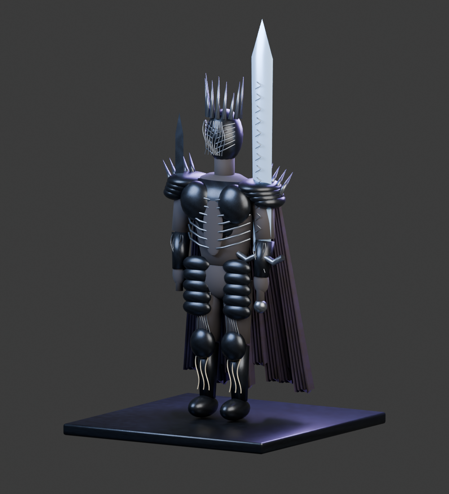
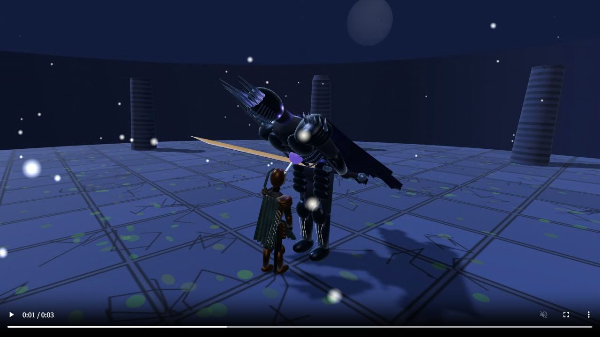
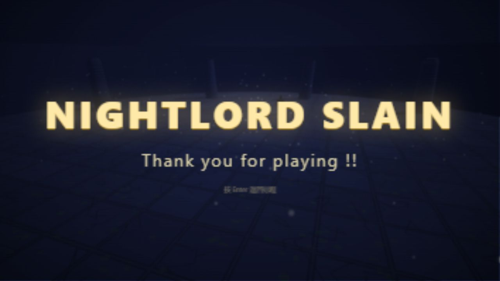

# R 喝药、隐士远程与布德奇冥处决更新

2026-10-16。当前游戏已接入以下改动，启动方式仍为 `start.bat` 或 `npm start`。

## 操作

| 场景 | 操作与效果 |
| --- | --- |
| 战斗中喝药 | **R**。H 不再喝药；仍需完成饮用动作，普通战斗中会被受击打断 |
| 死亡界面 | **R** 复活，恢复四瓶药。此时不会额外触发喝药 |
| 隐士轻击 | **鼠标左键**发射远程法术，空中或冲刺时同样为远程 |
| 隐士重击 | **按住右键蓄力，松开发射**。蓄力提高法术伤害和弹体大小 |
| 处决 | BOSS 破韧失衡时，靠近正面、面对 BOSS，**点击左键** |

隐士的普通攻击和蓄力攻击均通过实际弹体碰撞结算，没有附带近战伤害。锁定时瞄准 BOSS 躯干，未锁定时沿角色面向发射。轻击消耗 12 精力，蓄力法术消耗 22 精力；松开右键时精力不足则不发射。

处决是独立的近身特殊交互，隐士也可以触发，使用处决刀完成动作。

## 处决流程

全程约 **3.2 秒**：

1. 角色靠近并举刀，BOSS 固定为俯身失衡姿态。
2. 约 **0.68 秒**刺入胸部，结算第一段伤害。
3. 刀留在体内短暂停顿。
4. 约 **1.65 秒**开始缓慢拔出，约 **2.4 秒**结算第二段伤害。
5. 动作结束后恢复武器、操作和 BOSS AI；若已击杀，再进入死亡与胜利流程。

两段伤害分别为 `round(140 × 职业攻击倍率)` 和 `round(240 × 职业攻击倍率)`。例如执刑者为 **175 + 300**。每个处决交互各结算一次，不会在停顿或拔刀过程中按帧重复扣血。

期间固定 BOSS 的位置、朝向、姿态和攻击进度；双方的普通移动、攻击、喝药暂时停止，玩家不会被打断，其他伤害也不会混入这两次结算。暂停会冻结处决时间；重新挑战或返回标题会清理处决刀并恢复装备。

第一段已足以击杀时，仍会完成第二次拔刀打击，再播放胜利流程。生命值下限为 0，第二段不会让生命值变为负数。

动作采用关节层级和程序动画，参考原作的刺入、停顿、拔出流程，未使用原版动画文件。

## 布德奇冥模型

依据原作游戏画面重建尖冠封闭头盔、分段黑甲、镂空腹部轮廓、紫蓝破披风、巨剑和副手暗剑。游戏内巨剑在一阶段偏金色，二阶段转为紫蓝色。

- 游戏使用：[heolstor.glb](../assets/models/heolstor.glb)
- 可编辑源文件：[heolstor.blend](../assets/blender/heolstor.blend)
- 重建：`blender --background --factory-startup --python tools/build_heolstor.py`
- 编辑后导出：`blender --background --factory-startup --python tools/export_edited_models.py -- heolstor`
- 约 **25,858 个三角面、30 个网格、1 MB**，材质纹理内嵌。

视觉参考为原作游戏画面，来源：[BWIKI 布德奇冥条目](https://wiki.biligame.com/nightreign/%E5%B8%83%E5%BE%B7%E5%A5%87%E5%86%A5)、[Gameblog 游戏截图](https://www.gameblog.fr/jeu-video/ed/astuces/elden-ring-nightreign-guide-heolstor-698057)。参考图片不随游戏分发；本模型由项目脚本重新制作，精细度为轻量风格化初版。

## 验证与演示

- **24 项战斗专项检查**：R/H 区分、复活不误喝药、隐士地面与空中远程、蓄力加伤、刀尖实际插入与退出、处决两段伤害、BOSS 冻结、暂停、重开清理、第一段致死后的完整动作与胜利流程。
- **28 项基础浏览器回归**：四职业、移动、锁定、翻滚、跳跃、轻重击、血瓶、暂停、复活、二阶段、胜利与再次开局。
- **7 项本地检查**：五个 GLB 的格式、关节、内嵌纹理与体积，加两项服务器检查。
- **正常操作通关**：执刑者约 **56 秒**击败 BOSS，未死亡，经历二阶段并自然触发两段处决。脚本仅读取状态，以按键、鼠标事件战斗，没有修改生命值、位置或 BOSS AI。结果见 [playthrough.json](combat-update/playthrough.json)；攻击与喝药次数为输入尝试次数。

原始结果：[regression.json](combat-update/regression.json)。专项测试使用调试接口构造位置、伤害与 AI 暂停场景，实际攻击、喝药和处决由输入事件触发。

[查看实际游戏画布录制的处决演示](combat-update/execution.webm)。演示只用调试接口准备破韧场景，动作和伤害流程使用正常交互。

