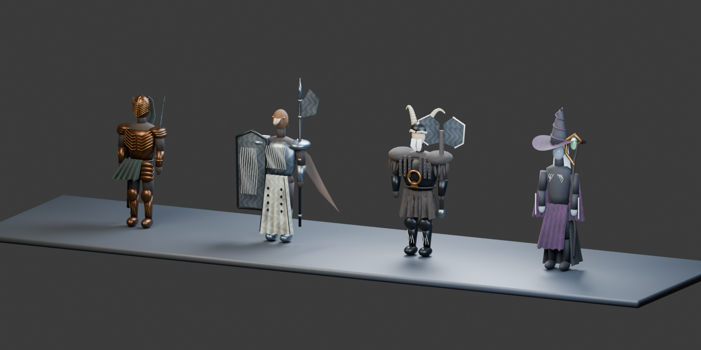
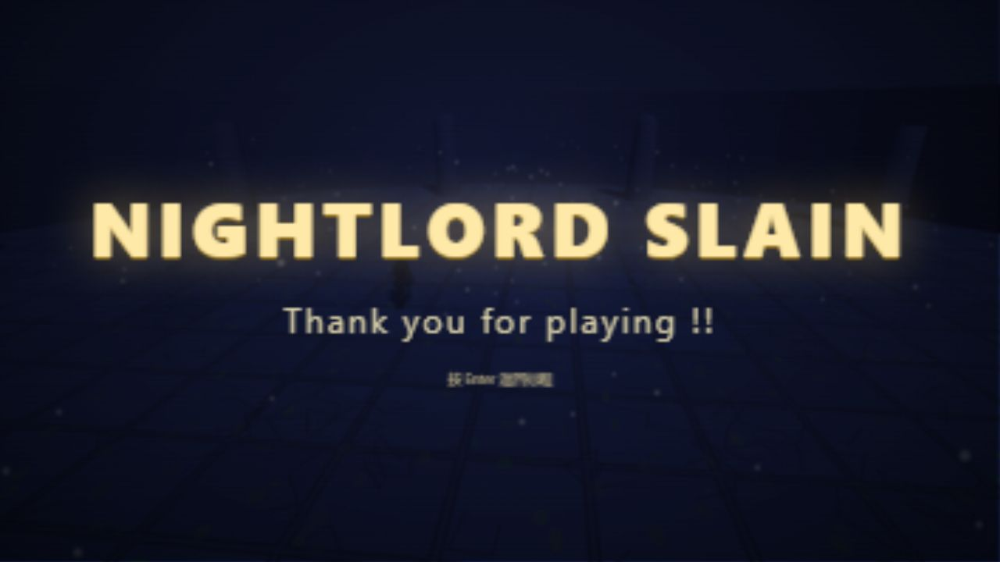

# Blender 人形角色替换

2026-10-16：四个可选职业由豆子模型替换为参考官方角色图制作的人形模型，加载与运行仍使用 Three.js，无需 Unity。游玩者也不需要安装 Blender。



## 官方参考来源

以下为万代南梦宫官方角色页面，实际查看了页面提供的角色渲染图，作为外形参考：

| 本作职业 / 模型文件 | 官方参考 | 本次重建的外形特征 |
| --- | --- | --- |
| 执刑者 / executioner.glb | [Executor](https://en.bandainamcoent.eu/elden-ring/elden-ring-nightreign/characters/executor) | 全覆面青铜头盔、胸甲纹饰、绿色披布、武士刀 |
| 守护者 / guardian.glb | [Guardian](https://en.bandainamcoent.eu/elden-ring/elden-ring-nightreign/characters/guardian) | 鸟首、银甲、羽翼、白色纹饰裙甲、长戟与大盾 |
| 无赖 / rogue.glb | [Raider](https://en.bandainamcoent.eu/elden-ring/elden-ring-nightreign/characters/raider) | 角盔、灰胡须、毛皮护肩、皮革铆钉、巨型武器轮廓 |
| 隐士 / hermit.glb | [Recluse](https://en.bandainamcoent.eu/elden-ring/elden-ring-nightreign/characters/recluse) | 弯曲宽檐尖帽、银发、紫黑长袍、刺绣宽袖、枝形法杖 |

模型网格、材质贴图和选角肖像均在本项目中重新制作；没有提取原游戏的模型、贴图或动画。官方参考图只作本地参考，未作为游戏素材加入仓库。角色形象与原作标识归原权利人所有。

这是一版参考图指导的轻量风格化重建，**不是官方原版模型，也不具有原版精度**。正面可见特征有依据，背面、被遮挡部分和装饰采用近似设计。脸部、手部、毛发与布料细节仍有简化。

## 交付文件

- [nightfarers.blend](../assets/blender/nightfarers.blend)：Blender 5.2.2 LTS 保存的四角色源文件，包含材质、贴图、关节层级与展示灯光。
- [assets/models](../assets/models/)：四个自包含 GLB，纹理内嵌，游戏无需联网获取模型素材。
- [assets/portraits](../assets/portraits/)：从真实模型渲染的选角图片。
- [manifest.json](../assets/models/manifest.json)：导出后的面数、大小等数据。

| 模型 | 三角面 | 网格数 | GLB 体积（约） |
| --- | ---: | ---: | ---: |
| 执刑者 | 17,584 | 33 | 1.06 MB |
| 守护者 | 13,725 | 31 | 1.10 MB |
| 无赖 | 16,718 | 27 | 1.08 MB |
| 隐士 | 15,108 | 25 | 0.77 MB |

`manifest.height` 为包含帽子、角和竖起武器的总高度，不等同于角色身高。模型按材质与关节合并装饰，控制绘制开销。

## 如何接入游戏

`js/nightfarers.js` 使用与仓库 Three.js r185 匹配的 GLTFLoader 预加载四个模型，按职业克隆实例并绑定 `body`、`head`、手臂、腿与武器关节。

游戏的待机、走路、冲刺、跳跃、挥剑、蓄力、喝血和翻滚由现有状态机驱动关节。人形版本调整了头部基准高度、肩部挥动和整身翻滚，并为金属材质补充环境反射。受击闪烁改为遍历新模型材质。切换职业时释放实例材质，共享几何和纹理保留在缓存中。

这里使用的是**刚性部件关节层级**，没有专业蒙皮、动作捕捉、手指动画或布料模拟。进一步精修时可在 Blender 增加完整骨骼与权重，并另行接入 AnimationMixer。

战斗判定、HP、精力与职业速度沿用原作业版本；外观武器换为刀、戟、巨斧和法杖，未同步改造成官方职业机制。无赖仍保留本作快速连击，守护者仍无格挡功能。BOSS 本次沿用旧豆骑士模型。

## 编辑与重新导出

日常修改建议直接用 Blender 打开并编辑 `assets/blender/nightfarers.blend`，保存后导出：

```bash
blender --background --factory-startup --python tools/export_edited_models.py
blender --background --factory-startup --python tools/render_portraits.py
```

若 `blender` 不在 PATH 中，使用本机 `blender.exe` 的完整路径。Windows PowerShell 调用带空格的路径时，在引号前加 `&`。

保留角色根对象的 `classId` 自定义属性，以及关节对象的 `part` 自定义属性。导出脚本会将展示排布恢复到原点，再导出选中角色，避免模型带着展示偏移进入游戏。

需要从参数脚本重建全部模型时：

```bash
blender --background --factory-startup --python tools/build_nightfarers.py
blender --background --factory-startup --python tools/render_portraits.py
```

**重建脚本会覆盖现有 GLB 和 .blend**；手工编辑后应使用前面的“编辑模型导出”脚本。导出完成后执行 `npm test`，并刷新浏览器检查动作和材质。导出脚本也会更新 manifest 中的模型统计。

## 验证

- `npm test`：6 / 6 通过，包含四个 GLB 的格式、关节、内嵌纹理和体积检查，以及两项服务器测试。
- 人形版本浏览器回归：28 / 28 通过，四个职业确认使用人形模型，移动、轻重击、弹幕、受伤、喝血、翻滚、暂停、复活、胜利与再开局正常。原始结果见 [smoke-result.json](models/smoke-result.json)。
- 普通按键通关：执刑者约 **94 秒**击败 BOSS，死亡重试 **1 次**，经历二阶段。仅读取状态，以正常输入事件进行战斗，不修改血量或坐标。结果见 [playthrough-result.json](models/playthrough-result.json)。攻击和喝血次数是指令尝试次数，不等于成功次数。
- Blender 展示渲染和 Chromium 实战画面均已检查；尚未做其他 GPU、浏览器和长时间性能测试。


