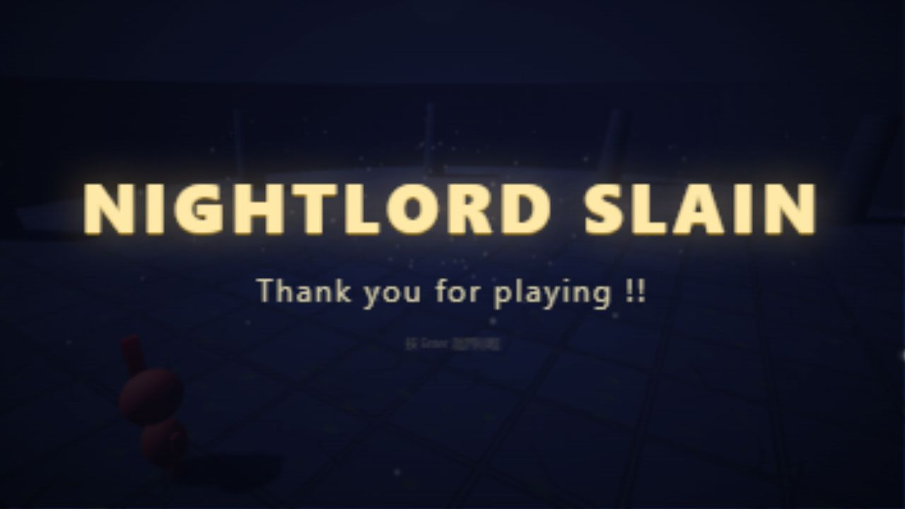

# 可玩性验证记录

日期：2026-10-16。验证对象是本仓库的 JavaScript / Three.js 浏览器版本。

## 结论

**具备完整可玩的单人 BOSS 战循环**：标题 → 四职业选择 → 战斗 → 死亡 / 复活 → 二阶段 → 胜利 → 返回标题 / 再次开局。

正常操作脚本使用执刑者，**88 秒击败 BOSS，死亡复活 1 次**，最终显示 `NIGHTLORD SLAIN`。脚本通过正常键盘、鼠标事件执行移动、锁定、轻击和喝血，只读取调试快照，未修改角色 / BOSS 血量、坐标或伤害。死亡后保留 BOSS 血量是游戏本身的规则。

原始结果见 [playthrough-result.json](playthrough-result.json)。`attacks: 112` 是点击尝试次数，包含空挥；`heals: 5` 是喝血指令次数，可能包含被打断的尝试，不代表成功命中或成功治疗次数。

## 测试环境与方法

- Windows，Node.js v24.12.0，本地 HTTP 服务。
- Chrome 完成初始菜单与画面检查；因自动化连接中断，完整功能回归和通关在 Codex 内置 Chromium 浏览器完成。
- 浏览器功能回归 28 项通过。初始检查在窄窗口执行；完整战斗后半段与胜利画面在 1280 × 720 桌面视口验证。
- 测试通过页面键盘 / 鼠标事件驱动真实游戏逻辑与渲染。指针锁定不可用时的自由视角降级已走通；持续原生鼠标捕获及实体设备手感仍需人工体验。
- 服务器测试使用 Node.js 内置测试运行器，无第三方测试依赖。

## 功能回归结果：28 / 28

| 范围 | 已验证内容 |
| --- | --- |
| 职业与开局 | 四职业生命值正确；新开局清理旧角色状态（4 项） |
| 激活战斗 | 点击前等待；点击后激活 BOSS（2 项） |
| 移动与防御 | W 移动、E 锁定 / 解锁、翻滚与无敌帧、跳跃（5 项） |
| 战斗与恢复 | 受到伤害、受伤后保护帧、血瓶恢复、轻击命中、蓄力重击命中（5 项） |
| 暂停 | 暂停取消蓄力、战斗冻结、失焦自动暂停（3 项） |
| 重试 | 死亡界面、R 复活保留 BOSS 生命、清除旧危险与动作（3 项） |
| BOSS 与结局 | 二阶段阈值、重新挑战重置、胜利界面、胜利返回标题、再次开局（5 项） |
| 隐士 | 右键豆能弹幕命中（1 项） |

功能回归通过 `?debug` 接口移动角色到指定位置、注入伤害和生成危险，稳定复现血瓶、无敌帧、复活、二阶段与胜利场景。这部分验证状态和判定，**不作为正常操作通关的证据**；正常战斗另由 `tests/playthrough.js` 完成。

## 服务器测试：2 / 2

1. 首页、四个游戏模块、Three.js 模块、样式返回成功；缺失文件返回 404，错误编码返回 400，隐藏文件和目录穿越被拦截。
2. 连续两个端口占用后，服务器仍能启动到后续空闲端口。

执行 `npm test`。GitHub Actions 会在提交后自动运行服务器测试与脚本语法检查；图形回归需在浏览器单独执行。

## 验证中修复的问题

- 新对局完整重置死亡、攻击、蓄力、跳跃、精力、药瓶和相机状态，避免上一局动作残留。
- 暂停、失焦、切换标签页时清除按键与鼠标状态，避免恢复后持续移动或蓄力。
- 忽略按键自动重复触发的一次性操作，避免长按 Shift 反复翻滚。
- 玩家点击画面启用视角前，不推进战斗，避免尚未开始操作就被攻击。
- 根据轻击、跳劈、冲刺攻击、近战重击与魔法的实际精力消耗检查是否可发动。
- 本地服务器支持多次端口回退，仅监听本机，并阻止隐藏文件与越界路径访问。
- 修正标题页提示和无赖职业描述，操作说明与实际功能保持一致。

## 体验评价与边界

- 核心反馈完整：生命、精力、BOSS 血条、锁定、伤害数字、受伤保护与胜负界面都能参与实际战斗。
- 反复复活可累积消耗 BOSS 生命，对新手宽容；本次基础移动与轻击策略即可通关，未评估高难度挑战或长期平衡。
- 重击需要出招窗口，蓄力会被受击打断；守护者没有格挡，无独立处决按键。
- 手机窄屏下文字容易拥挤，且没有触屏操作，当前面向桌面键鼠。
- 未测 Firefox、Safari、其他 GPU、离线断网环境、长时间内存稳定性、实体设备输入延迟；未提供 FPS 或性能保证。
- 完整战斗验证使用执刑者；其余职业完成初始化与专项检查，不代表全部职业已独立通关。二阶段战斗和扩散波出现已验证，不宣称穷尽随机 AI 的每种招式。
- 这是单场 BOSS 战原型，无存档、联机或额外关卡。
