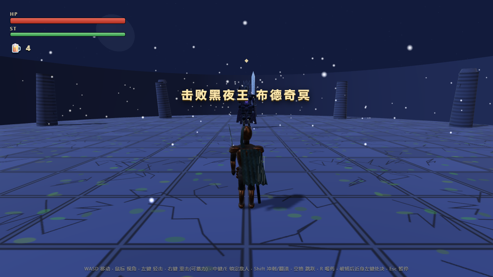

# Windows 便携版 0.0.1

下载 [GitHub Release v0.0.1](https://github.com/bujue53/elden-bean-beanreign/releases/tag/v0.0.1) 中的 **ELDEN-BEAN-BEANREIGN-0.0.1-win-x64.zip**。完整解压后运行 **ELDEN BEAN.exe**，同目录的运行库和 resources 文件夹需要一起保留。

## 运行方式

- 独立游戏窗口，默认内容区域 1280 × 720，可调整大小。
- F11 或 Alt+Enter 切换全屏；Esc 仍为游戏内暂停；关闭窗口退出。
- 内置 Electron 44.8.0、Chromium 和运行环境，无需安装 Node.js、Unity 或 Blender。
- 通过本地 `bean://game/` 资源协议加载游戏与模型，无需 HTTP 服务、端口或联网。
- Windows 10/11 x64、支持 WebGL 2 的显卡及驱动、键盘和鼠标。其他系统没有打包验证。

完整操作见 [游玩说明](WINDOWS-README.txt)。原网页入口与开发服务器仍可使用。

## 打包与验证

构建需要 Windows 和 Node.js 22.12+，建议 24：

```bash
npm ci
npm run build:win
```

`tools/build-windows.cjs` 只复制游戏代码、运行素材、桌面入口和回归脚本，使用 ASAR 打包并生成 ZIP；Blender 源文件、参考图片、演示视频和开发依赖不进入便携包。游戏名称、图标以及 EXE 的文件版本、产品版本均已写入，版本为 **0.0.1**。

2026-10-16，在本机 Windows 对最终 ZIP 进行如下检查：

- 从 ZIP 解压到包含中文和空格的另一目录，通过其中的 EXE 启动。
- 启动时从 PATH 中排除 Node.js，仅保留 Windows 系统目录；加载成功。
- 阻断并记录所有 HTTP/HTTPS 请求；完整回归期间没有外部网络请求。
- 窗口模式、F11 全屏及返回窗口正常；WebGL 2 正常；渲染页面没有暴露 Node.js 接口；正常启动不暴露游戏调试接口。
- 在打包后的 EXE 内完成 **24 项战斗专项 + 28 项基础回归**，且没有控制台错误，包括模型内嵌贴图加载。测试使用调试场景构造及输入事件，不代表真人操作通关测试。
- **9 项本地检查**通过：模型、服务器，以及桌面资源路径边界。

原始记录：[result.json](windows/result.json)。实机画面从打包后的游戏窗口内容捕获：



桌面入口保持 `contextIsolation`、`sandbox` 和默认 Web 安全检查开启；禁止新窗口与外部页面跳转，仅允许游戏所需的指针锁定权限。GLB 内嵌纹理的本地 Blob 加载已纳入资源策略。

本版没有商业代码签名，也未在其他电脑、其他显卡或全新 Windows 安装中测试。不同机器的性能与驱动兼容性仍需实际反馈。

参考实现依据：[Electron 窗口](https://www.electronjs.org/docs/latest/api/browser-window)、[本地协议](https://www.electronjs.org/docs/latest/api/protocol)、[安全建议](https://www.electronjs.org/docs/latest/tutorial/security)、[Packager](https://electron.github.io/packager/main/interfaces/Options.html)。
